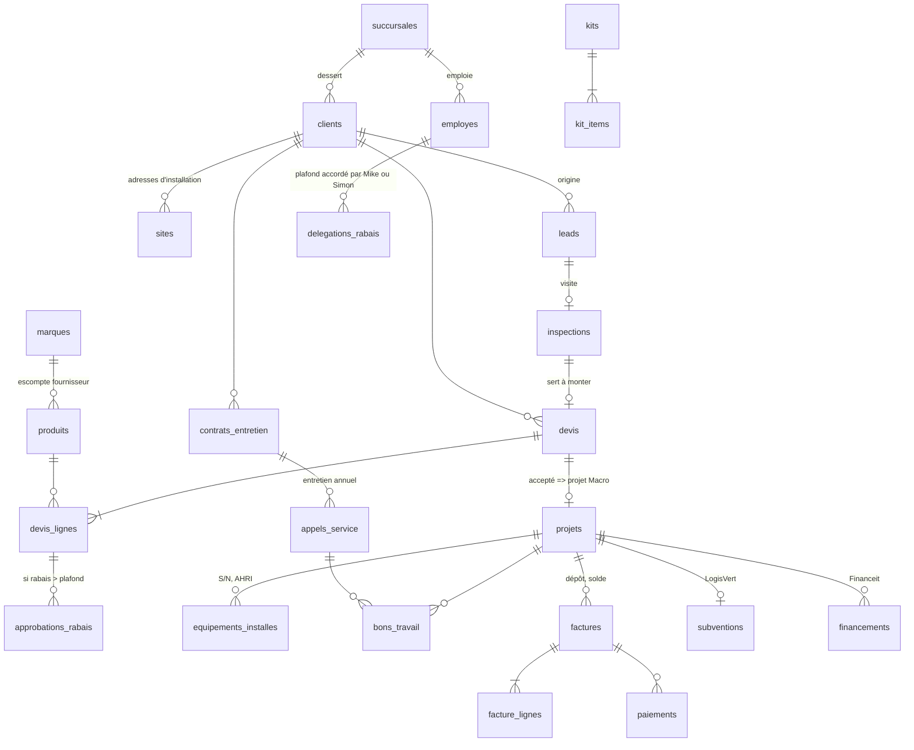

# Modèle de données | Phase 1

> **Statut : proposé, NON appliqué.** Les migrations sont dans `supabase/migrations/`. Elles ont été testées seulement sur un Postgres local jetable (`tests/sql/run.sh`). Aucun projet Supabase n'a été créé ni touché.

## 1. Vue d'ensemble

35 tables, regroupées en 8 domaines.

| Domaine | Tables | Rôle |
|---|---|---|
| **Référentiels** | `succursales`, `divisions`, `taux_taxes`, `parametres`, `formats_numerotation`, `compteurs` | Configuration. Les taxes, les formats de numéros et les blocages se règlent ici, sans toucher au code. |
| **Personnes** | `employes`, `employe_succursales`, `certifications`, `fournisseurs` | Qui travaille, où, avec quels droits et quelles certifications. Les sous-traitants sont des `fournisseurs` de type `sous-traitant`. |
| **CRM** | `clients`, `sites`, `leads`, `inspections`, `documents` | Du premier contact à l'inspection, avant le devis (ADR-007). |
| **Catalogue** | `marques`, `produits`, `kits`, `kit_items` | Produits HVAC, escompte fournisseur par marque, kits de thermopompes. |
| **Ventes** | `devis`, `devis_lignes`, `approbations_rabais`, `delegations_rabais` | Devis numérotés, rabais plafonnés, approbations tracées. |
| **Opérations** | `projets`, `equipements_installes`, `bons_travail`, `bt_lignes`, `appels_service`, `contrats_entretien` | Projets Macro, installation, numéros de série, service après-vente. |
| **Argent** | `factures`, `facture_lignes`, `paiements`, `financements`, `subventions` | Dépôt de 40 %, solde de 60 %, Financeit, LogisVert. |
| **Traçabilité** | `journal_audit` | Qui a fait quoi, quand (Loi 25, rabais, factures). Impossible à modifier. |

## 2. Relations principales

## 3. Qui voit quoi (RLS)

| Rôle | Clients, leads, devis, projets | Factures, paiements | Bons de travail | Journal d'audit | Référentiels |
|---|---|---|---|---|---|
| **Admin tout** (Mike, Simon) | Tout | Tout, écriture | Tout | Lecture | Lecture, écriture |
| **Direction** | Tout | Tout, écriture | Tout | Lecture | Lecture, écriture |
| **Comptabilité** | Tout (lecture et écriture) | Tout, écriture | Tout | Non | Lecture |
| **Gérant de succursale** | Ses succursales | Ses succursales, écriture | Ses succursales | Non | Lecture |
| **Coordonnateur** | Ses succursales | Ses succursales, écriture | Ses succursales | Non | Lecture |
| **Vendeur** | Ses succursales (ADR-006) | Ses succursales, **lecture seule** | Ses succursales | Non | Lecture |
| **Technicien** | **Seulement les clients et projets de ses BT, appels ou inspections** | Non | Ses BT, mise à jour | Non | Lecture |
| **anon** (clé publique sans session) | Rien | Rien | Rien | Rien | Rien |

Autres règles d'accès :
- **Aucune suppression** par l'API, sauf retirer une ligne d'un devis ou d'une facture **en brouillon**. On archive par statut.
- **Approuver un rabais hors plafond** : seulement les employés `peut_approuver_rabais` (Mike, Simon).
- **Accorder ou révoquer un plafond délégué** : seulement Mike et Simon.
- **Compteurs** : personne ne les lit ni ne les écrit directement, seulement la base elle-même.
- **Les fonctions serverless** interrogent la base avec le jeton de l'utilisateur, donc la RLS s'applique aussi à elles. La clé `service_role` reste réservée aux tâches système (crons, migrations).

## 4. Règles métier appliquées PAR LA BASE

Ces règles tiennent même si le front ou une fonction a un bogue :

| Règle | Où | Testée |
|---|---|---|
| Numéros séquentiels sans trou, jamais décrémentés | `app.prochain_numero` + `compteurs` | ✅ rollback, décrément, suppression |
| Numéro de devis à la création, numéro de facture **à l'émission** (un brouillon abandonné ne crée pas de trou) | triggers `devis_numero`, `facture_avant` | ✅ |
| Taxes en cents : TPS 5 %, TVQ 9,975 %, arrondi au cent le plus proche, taux datés | `app.taxes` | ✅ 100 $, 450 $, 0,01 $, négatif, exemption |
| Plafond de rabais = escompte fournisseur moins 35 points, exception par marque, ou plafond délégué | `app.plafond_rabais_bp` | ✅ |
| Devis non envoyable tant qu'un rabais hors plafond n'est pas approuvé | `devis_statut_garde` | ✅ |
| Devis envoyé = lignes figées | `devis_ligne_calcul` | ✅ |
| Totaux calculés par la base, une saisie manuelle est ignorée | triggers devis et facture | ✅ |
| Facture émise = figée, correction par note de crédit (série distincte) | `facture_avant` | ✅ |
| Statut « payée » = somme des paiements, jamais à la main | `paiement_apres` | ✅ |
| Paiement non modifiable, remboursement = montant négatif | `trg_paiement_immuable` | ✅ |
| Facture de solde ou finale bloquée si une pièce LogisVert manque : S/N, AHRI ou ENERGY STAR, BTU, photo de la plaque, date d'installation, nom identique à la preuve de propriété | `app.manques_logisvert` | ✅ |
| Date limite LogisVert = première mesure + 9 mois | `subvention_avant` | ✅ |
| Solde dû 72 h avant l'installation (configurable) | `projet_avant` | ✅ |
| Certification expirée : informatif, bloquant si le paramètre est activé | `bt_certif_garde` | ✅ les deux cas |
| Journal d'audit impossible à modifier ou à supprimer | `trg_journal_immuable` | ✅ |
| Numéros Hydro-Québec du client stockés seulement avec consentement daté | contrainte `clients` | |

## 5. Conventions

- **Argent** : `bigint` en cents. **Rabais** : points de base (`500` = 5 %). **Taux de taxe** : pcm (`9975` = 9,975 %). Aucun `float`.
- **Champ `division`** sur toutes les tables métier, avec les mêmes libellés que chez Mike.
- **Colonnes de migration** : `monday_board_id`, `monday_item_id`, `source`, `synced_at` (voir `docs/MAPPING.md`).
- **Fonctions internes** dans le schéma `app`, tables dans `public` (convention Supabase).

## 6. Points à confirmer (ils ne bloquent pas la Phase 2)

1. **Format des numéros** de devis, facture et projet de Mike. Les formats actuels sont provisoires et se changent dans `formats_numerotation`, sans migration :
   - devis `D-2026-00001`
   - facture `F-2026-00001`
   - note de crédit `NC-2026-00001`
   - projet `ROV-001-26`. ⚠️ Ce n'est **pas** le format `XXX-XXX-XXX` de Mike : il me faut 3 vrais codes pour le reproduire.
2. **Libellés des rôles** chez Mike, sauf « Admin tout ».
3. **Rabais sur un kit** : pour l'instant, seul le plafond délégué s'applique (aucun plafond automatique). Faut-il utiliser l'escompte de la marque principale du kit ?
4. **Vendeurs et factures** : en lecture seule. Doivent-ils pouvoir créer la facture de dépôt ?
5. **Taxes** : je calcule la TPS et la TVQ sur le sous-total taxable du document, et non ligne par ligne. Est-ce aussi la méthode de Mike ?
6. **Financeit** : à quel moment Financeit verse-t-il l'argent, et qu'est-ce que ça change au dépôt de 40 % et au solde de 60 % ?
7. **Inventaire** (emplacements, stock, BC, réception) : pas modélisé. Ça viendra avec le module catalogue et inventaire, en Phase 3.

## 7. Ajouts Phase 3 (module Clients + Devis)

| Objet | Rôle |
|---|---|
| `devis_v` (vue, `security_invoker`) | Devis + client + vendeur + `statut_effectif` (inclut « expire ») + `bloque_par_rabais`. Respecte la RLS de l'appelant. |
| `hvac_prix_kit(kit)` | Prix fixe du kit, sinon la somme des composantes |
| `hvac_dupliquer_devis(devis)` | Renouvellement : nouveau numéro, mêmes lignes, en brouillon |
| Paramètre `validite_devis_jours` | 30 jours à partir de l'envoi |
| Trigger de ligne | Prix imposé par le catalogue, plafond 0 % sur les kits |
| Trigger de statut | Brouillon -> envoyé -> accepté ou refusé ; devis vide refusé ; devis expiré non acceptable |
| `types_travaux` | Types de travail d'installation (murale, centrale, échangeur...) |
| `tarifs_sous_traitants` | Grille datée des coûts par sous-traitant et type de travail. Non modifiable : on ajoute un tarif. Invisible aux techniciens. |
| Paramètre `marge_installation_bp` | Marge sur le prix de vente, 25 % par défaut (ADR-036), ajustable par Simon et Mike |
| `devis_lignes.type_ligne` | `produit`, `kit`, `installation`, `libre` |
| Ligne d'installation | Sous-traitant obligatoire, coût (grille ou soumission), marge figée, prix = coût / (1 − marge), plafond de rabais 0 % |

